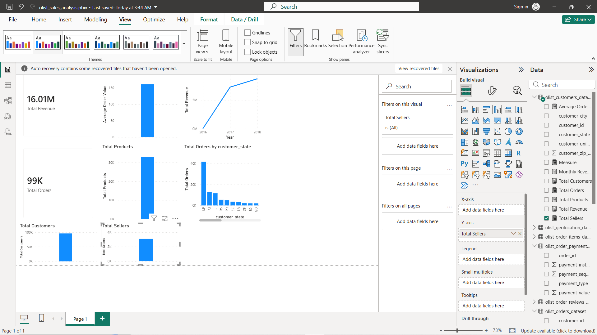

# E-Commerce Business Intelligence & Sales Analysis

## Project Overview
This project analyzes the Olist Brazilian E-Commerce dataset to identify sales trends, customer behavior, product performance, and business insights.

## Tools & Technologies
- Microsoft Excel
- SQL
- Python
- Power BI

## Dataset
Olist Brazilian E-Commerce Public Dataset from Kaggle.

## Project Workflow
1. Data preparation and cleaning using Excel
2. Data analysis using SQL
3. Exploratory data analysis using Python
4. Interactive dashboard development using Power BI
5. Business insights and recommendations

## Project Status
Data preparation completed. Analysis and dashboard development in progress.
## Dashboard
Created an interactive Power BI dashboard featuring:
- Revenue and order KPIs
- Monthly revenue trend
- Product category analysis
- Payment method analysis
- Customer state analysis
- ## Dashboard Preview

